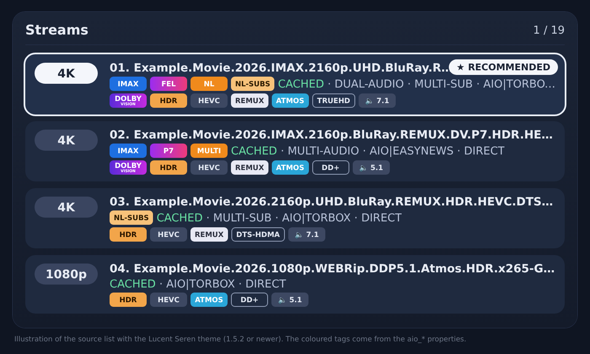
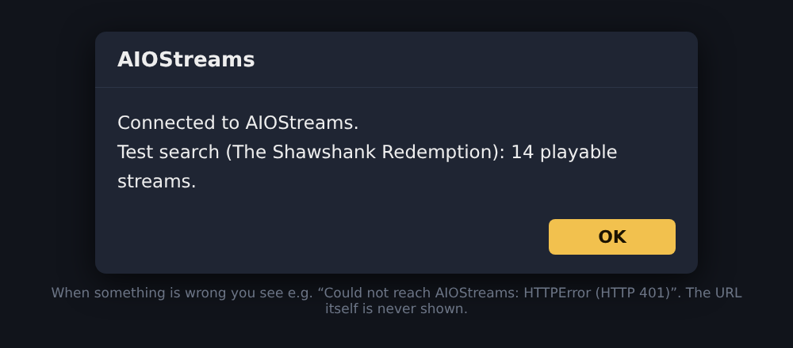
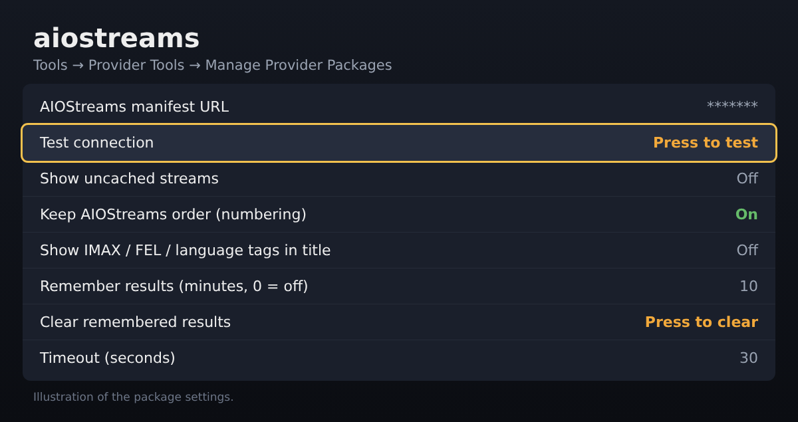

# AIOStreams Scraper for Seren

A provider package for the Kodi add-on **[Seren](https://github.com/nixgates/plugin.video.seren)** that gets its sources from your own **[AIOStreams](https://github.com/Viren070/AIOStreams)** setup.

AIOStreams does the heavy lifting. It searches all your add-ons (Comet, StremThru, Easynews and more), filters out the junk and sorts the results. Seren shows the list and plays the stream.

**Current version: 1.1.1** · [Changelog](CHANGELOG.md) · [Releases](../../releases)



*Illustration of the source list with the [Lucent Seren theme](https://github.com/djdirty60/Seren-Thema) 1.5.2 or newer: 4K remuxes on top, with coloured `IMAX`, `FEL`/`P7`, `NL`/`MULTI` and `NL-SUBS` badges and `CACHED` status. Other themes may show the tags differently.*

---

## Features

- **One source for everything:** every add-on, debrid service and Easynews account you set up in AIOStreams comes into Seren through a single provider.
- **Keeps the AIOStreams order:** each title gets a number (`01.`, `02.`, …), so Seren lists streams in exactly the order AIOStreams sorted them. For example, 4K REMUX with Dolby Vision and Atmos stays on top.
- **Full stream details:** resolution, Dolby Vision, HDR, HYBRID, REMUX, BluRay, WEB, Atmos, TrueHD, DTS:X, DTS-HD MA, DD+, 7.1/5.1 and codec (HEVC/AVC/AV1) come straight from AIOStreams. Seren can filter and sort on them too.
- **File size included:** Seren's size filter works as normal.
- **Only playable streams:** uncached streams are hidden by default. You can turn them on in the settings.
- **Extra tags:** `IMAX`, `FEL` (or `P7`), `NL`/`MULTI` and `NL-SUBS`, things Seren can't show on its own. They're passed to the skin as list item properties (see *For theme makers* below), and can optionally be put in front of the title: `01. [IMAX FEL NL] Movie.2026.2160p.BluRay.REMUX…`
- **Language info for Seren:** dual/multi audio, multiple subtitles and cached status are passed to Seren as `DUAL-AUDIO`, `MULTI-AUDIO`, `MULTI-SUB` and `CACHED`.
- **Remembers results for a short while:** open the same movie again and the sources appear instantly (10 minutes by default).
- **Test connection button:** checks your manifest URL and runs a test search, right from the package settings.
- **Automatic updates:** Seren finds new versions through *Provider Tools → Check for updates*.
- **Clear source labels:** for example `AIO|TORBOX` or `AIO|EASYNEWS`.
- **Movies and TV shows:** uses IMDb IDs, with TMDB IDs as a fallback.
- **Fails safely:** if AIOStreams can't be reached, Seren carries on with your other providers.
- **No secrets in the log:** your manifest URL is never written to `kodi.log`, and it's masked in the settings screen.

## How it works

1. You pick a movie or episode in Seren.
2. The scraper asks your AIOStreams instance for streams:
   `https://<your-aiostreams>/stremio/<your-config>/stream/movie/tt1234567.json`
3. AIOStreams searches, filters and sorts using your settings or template.
4. The scraper converts the response into Seren sources of type **direct**.
5. When you pick a source, Seren plays the AIOStreams link directly, and AIOStreams handles the debrid link behind the scenes.

The scraper asks AIOStreams for its extra stream metadata (`streamData`). That way Seren gets the details AIOStreams already parsed and doesn't have to guess them from the file name.

## Requirements

- Kodi with **Seren 3.x**
- A working **AIOStreams** configuration (public instance or self-hosted)
- A debrid service (e.g. TorBox, Real-Debrid) and/or **Easynews**, configured in AIOStreams
- Your AIOStreams **manifest URL**

---

## Installation

### Step 1: Download the package
Download `seren-aiostreams-provider.zip` from [Releases](../../releases). Do **not** unzip it.

### Step 2: Copy it to your device
Put the zip on the device that runs Kodi, for example:
- **Fire TV / Android TV:** use the *Send Files to TV* app or a USB stick
- **PC:** leave it in your Downloads folder

### Step 3: Install it in Seren
1. Open **Seren**.
2. Go to **Tools → Provider Tools → Install Package**.
3. Choose **Browse...** and select `seren-aiostreams-provider.zip`.
4. Confirm with **Install**.

> If you already have a package named `aiostreams`, this one replaces it.

### Step 4: Copy your manifest URL from AIOStreams
1. Open your AIOStreams configuration page.
2. Click **Save**.
3. Copy the **manifest URL**. It looks something like this:
   `https://your-aiostreams.com/stremio/xxxx/yyyy/manifest.json`

### Step 5: Enter the URL in Seren
1. Go to **Tools → Provider Tools → Manage Provider Packages → aiostreams**.
2. Select **AIOStreams manifest URL** and paste your URL.
3. Select **Test connection**. You should see *"Connected to AIOStreams"* and the number of streams found in a test search.

   

> 💡 **Tip:** typing a long URL with a remote is a pain. With the **Kore** or **Yatse** app on your phone you can paste text straight into Kodi.

### Step 6: Configure Seren (recommended)
Go to **Seren → Settings → Sort & Filter**:

| Setting | Value | Why |
|---|---|---|
| **Sort Level 1** | `None` | Seren keeps the AIOStreams order |
| **Movie File Size limit** | `100` (GB) | Otherwise Seren hides large 4K remuxes |
| **Episode File Size limit** | `40` (GB) or higher | Same, for episodes |

Done! Search for a movie and the AIOStreams sources show up in the list.

---

## Package settings

You'll find these under **Tools → Provider Tools → Manage Provider Packages → aiostreams**.



| Setting | Default | Description |
|---|---|---|
| AIOStreams manifest URL | *(empty)* | Your personal manifest URL. Required. Shown as `*******`. |
| Test connection | button | Checks the URL and runs a test search. Shows the result in a pop-up. |
| Show uncached streams | Off | Turn on to also show streams that still need to download. |
| Keep AIOStreams order (numbering) | On | Puts numbers in front of titles so Seren follows the AIOStreams order. |
| Show IMAX / FEL / language tags in title | Off | Adds tags like `[IMAX FEL NL]` in front of the title. Turn on if your Seren theme doesn't show the `aio_*` properties. |
| Remember results (minutes, 0 = off) | 10 | Opening the same title again within this time skips the wait. |
| Clear remembered results | button | Empties the result cache, e.g. after changing your AIOStreams setup. |
| Timeout (seconds) | 30 | How long the scraper waits for AIOStreams at most. |

> Updating from an older version? Settings you already had keep their old name and value; the new ones are added.

---

## AIOStreams template included

This scraper shows exactly what AIOStreams returns, so your AIOStreams sorting decides what ends up on top. This repo includes a ready-made template: [`template/ultra-dv-fel-remux.json`](template/ultra-dv-fel-remux.json).

What it does:
- **4K always above 1080p**, cached streams first.
- **Scores** for Dolby Vision FEL/P7, 4K REMUX, top remux release groups (FraMeSToR, BLURANiUM, …), IMAX, Atmos/DTS:X, TrueHD/DTS-HD MA and 7.1.
- **Dutch audio and subtitles** preferred, but only between streams of equal quality.
- **Removes** fake remuxes (a 4K REMUX movie under 20 GB, a 1080p REMUX movie under 10 GB), regrades, upscales, 3D and cam rips.
- **Failover:** if a stream fails, AIOStreams tries the next one.
- **Precache:** the next episode of a show is cached in the background.
- **Bitrate cap of 150 Mbps** against broken files. Lower it if your device stutters.
- Debrid and **Easynews** sources.

To use it: open AIOStreams → **About → Get Started → Load Template → Import**, choose the file, pick your debrid service and/or Easynews and enter your keys.

---

## Updating

Go to **Seren → Tools → Provider Tools → Check for updates** (works from version 1.0.2). Or install the new zip by hand through *Install Package*; your manifest URL is kept.

---

## For theme makers

Every source from this scraper carries these list item properties. A property is only set when it applies; the value is the text to show.

| Property | Value |
|---|---|
| `ListItem.Property(aio_imax)` | `IMAX` |
| `ListItem.Property(aio_fel)` | `FEL` or `P7` |
| `ListItem.Property(aio_lang)` | `NL` or `MULTI` |
| `ListItem.Property(aio_nlsubs)` | `NL-SUBS` |

Example: `<visible>!String.IsEmpty(ListItem.Property(aio_fel))</visible>` with `<label>$INFO[ListItem.Property(aio_fel)]</label>`.

The [Lucent Seren theme](https://github.com/djdirty60/Seren-Thema) shows them as labels on the provider line.

---

## Troubleshooting

| Problem | Fix |
|---|---|
| Not sure if your URL works | Use **Test connection** in the package settings. |
| Changed your AIOStreams setup but old results show | Use **Clear remembered results**, or set *Remember results* to `0`. |
| Install via *Web Location* does nothing | Seren gives no error when the download fails. Download the zip on your phone or PC and use **Browse...** instead. |
| No AIOStreams sources in the list | Check that the manifest URL is correct and the provider is **enabled** under Manage Provider Packages. |
| Large remuxes are missing | Raise the **File Size limit** in Seren (Step 6). |
| Order looks wrong | Set **Sort Level 1** to `None` and check your sorting in AIOStreams. |
| Only 1080p, no 4K | Check that **Max Resolution** is set to `4K` under Seren → Sort & Filter. |
| Stream won't start | Try the same stream in Stremio or Nuvio. If it fails there too, the problem is AIOStreams or your debrid service. |
| Finding errors | Turn on debug logging in Kodi and search the log for `[AIOStreams]`. |

---

## Limitations

- Plain **P2P torrents** without debrid are skipped. Only streams that play directly are passed through.
- Seren can't filter or sort on language itself; the `NL` tags are for display. Use the AIOStreams template to put Dutch first.
- Versions before 1.0.2 can't update themselves. Install 1.0.2 or newer once by hand; after that, *Check for updates* works.

---

## File structure

```
template/ultra-dv-fel-remux.json      # AIOStreams template (import in AIOStreams)
assets/                               # images used in this README
packages/aiostreams-<version>.zip     # update files Seren downloads
meta.json                             # tells Seren the latest version

seren-aiostreams-provider.zip
├── meta.json                          # package name, version and settings
├── providers/aiostreams/
│   └── en/
│       ├── __init__.py                # registers the provider as 'direct'
│       └── direct/aiostreams.py       # Seren hook (movie / episode)
└── providerModules/aiostreams/
    └── core.py                        # fetching, converting, cache, test button
```

---

## Privacy

Your manifest URL contains your **encrypted AIOStreams configuration**, which gives access to your debrid and Easynews accounts. **Never share it**, and never post it in an issue or screenshot.

## Disclaimer

This package does not host or distribute any content. It only requests links from your own AIOStreams configuration. You are responsible for how you use it and for following the law and the terms of the services you use.

This project is not affiliated with Seren, AIOStreams, Kodi or any debrid service.
